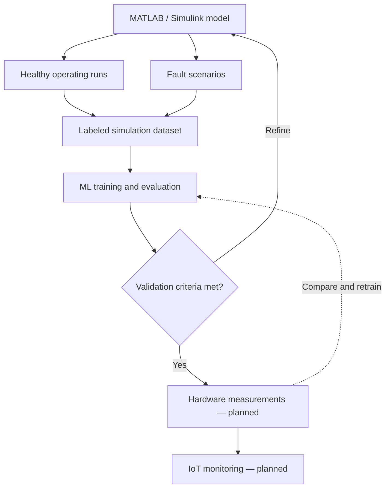

<!-- HEADER -->

<h1 align="center">☀️ Predictive Maintenance of Solar Inverter</h1>

<h3 align="center">Using IoT &amp; Machine Learning</h3>

  <b>MATLAB/Simulink · Data Generation · ML Training · Hardware · IoT</b>

  

  
  
  

  
  

  <a href="#overview">Overview</a>
  &nbsp;•&nbsp;
  <a href="#simulation">Simulation</a>
  &nbsp;•&nbsp;
  <a href="#dataset">Dataset</a>
  &nbsp;•&nbsp;
  <a href="#machine-learning">Machine Learning</a>
  &nbsp;•&nbsp;
  <a href="#hardware-iot">Hardware &amp; IoT</a>
  &nbsp;•&nbsp;
  <a href="#roadmap">Roadmap</a>

---

<!-- OVERVIEW -->

<h2 align="center">🔍 Understanding Inverter Health Through Data</h2>

  This ongoing final-year project explores
  <b>predictive maintenance for a solar inverter</b>
  through MATLAB/Simulink modeling, simulation-generated datasets,
  machine learning, and a planned hardware implementation with IoT monitoring.

  The current work focuses on generating data from
  <b>healthy and faulty inverter operation</b>
  and using an expanding dataset to train and evaluate machine-learning models.

  Fault studies include <b>DC-link capacitor degradation</b>
  and <b>IGBT/MOSFET switching faults</b>.
  Random Forest and LSTM approaches are being explored for fault analysis,
  with remaining useful life estimation as a further research objective.

  <b>
    First, develop and validate the simulation and ML workflow.
    Then, extend the approach to hardware measurements and IoT monitoring.
  </b>

---

<!-- PROJECT PHASES -->
<h2 align="center">🧭 Two Phases, One Connected Goal</h2>

<table align="center">
  <tr>
    <td width="50%" align="center" valign="top">
      <h3>🖥️ Phase 1 · Simulation &amp; ML</h3>
      

        
      

      

        Develop the inverter model. 
        Generate healthy and faulty operating data. 
        Expand and prepare the training dataset. 
        Train models and evaluate fault analysis.
      

      

        <code>MATLAB</code>
        <code>Simulink</code>
        <code>Data Generation</code>
        <code>ML</code>
      

    </td>
    <td width="50%" align="center" valign="top">
      <h3>🔌 Phase 2 · Hardware &amp; IoT</h3>
      

        
      

      

        Develop the hardware prototype after simulation validation. 
        Acquire physical measurements. 
        Integrate networked monitoring and logging. 
        Evaluate models using hardware data.
      

      

        <code>Sensing</code>
        <code>Data Acquisition</code>
        <code>IoT</code>
        <code>Validation</code>
      

    </td>
  </tr>
</table>

---

<!-- SIMULATION -->

<h2 align="center">⚡ Inside the MATLAB/Simulink Model</h2>

  

  
    Current simulation model · Click the image to inspect the full diagram.
  

<table align="center">
  <thead>
    <tr>
      <th align="center">Model Section</th>
      <th align="center">Role</th>
    </tr>
  </thead>
  <tbody>
    <tr>
      <td align="center"><b>☀️ PV Source</b></td>
      <td align="center">Represents the solar source with irradiance and temperature inputs.</td>
    </tr>
    <tr>
      <td align="center"><b>🔋 DC–DC Boost Stage</b></td>
      <td align="center">Conditions the PV-side DC voltage before the inverter stage.</td>
    </tr>
    <tr>
      <td align="center"><b>⚡ DC Link</b></td>
      <td align="center">Connects the converter and inverter stages through a DC energy buffer.</td>
    </tr>
    <tr>
      <td align="center"><b>🔄 Full-Bridge Inverter</b></td>
      <td align="center">Uses four controlled switches to produce an AC output from the DC supply.</td>
    </tr>
    <tr>
      <td align="center"><b>〰️ PWM Generation</b></td>
      <td align="center">Uses reference and carrier signals to generate inverter switching commands.</td>
    </tr>
    <tr>
      <td align="center"><b>🔌 Output Filter &amp; Load</b></td>
      <td align="center">Includes an LC output filter and a resistive load.</td>
    </tr>
    <tr>
      <td align="center"><b>📊 Measurements</b></td>
      <td align="center">Includes voltage observation, RMS measurement, and THD monitoring.</td>
    </tr>
  </tbody>
</table>

  <b>The model is being developed as the foundation for data generation and fault studies.</b>

---

<!-- FAULT STUDIES -->
<h2 align="center">🩺 What Is Being Investigated?</h2>

<table align="center">
  <tr>
    <td width="33%" align="center" valign="top">
      <h3>🟢 Healthy Operation</h3>
      

        Establish reference behavior for the inverter
        and characterize its signals under normal operating conditions.
      

    </td>
    <td width="33%" align="center" valign="top">
      <h3>🟡 Capacitor Degradation</h3>
      

        Study how DC-link capacitor degradation
        affects inverter signals and potential condition indicators.
      

    </td>
    <td width="33%" align="center" valign="top">
      <h3>🔴 Switching Faults</h3>
      

        Investigate IGBT/MOSFET switching faults
        and their effects on inverter operation and output waveforms.
      

    </td>
  </tr>
</table>

  <b>Research question:</b>
  Which measurable changes help distinguish normal operating variation
  from developing faults?

---

<!-- DATASET -->

<h2 align="center">🗂️ Building the Dataset in MATLAB</h2>

  <b>Simulation is also the project's data source.</b>

  Data is being generated through MATLAB/Simulink runs
  and used for machine-learning training.
  The dataset is being expanded to support analysis across
  multiple operating conditions and fault scenarios.

<h3 align="center">Dataset Coverage Being Developed</h3>

<table align="center">
  <thead>
    <tr>
      <th align="center">Category</th>
      <th align="center">Intended Coverage</th>
    </tr>
  </thead>
  <tbody>
    <tr>
      <td align="center"><b>Operating Conditions</b></td>
      <td align="center">Variation in irradiance, temperature, and load conditions.</td>
    </tr>
    <tr>
      <td align="center"><b>System Condition</b></td>
      <td align="center">Healthy operation, capacitor degradation, and switching-fault scenarios.</td>
    </tr>
    <tr>
      <td align="center"><b>Time-Series Signals</b></td>
      <td align="center">Logged inverter signals for waveform and temporal analysis.</td>
    </tr>
    <tr>
      <td align="center"><b>Candidate Features</b></td>
      <td align="center">RMS values, THD, ripple measures, and other signal statistics.</td>
    </tr>
    <tr>
      <td align="center"><b>Labels &amp; Metadata</b></td>
      <td align="center">Simulation run identifiers, operating settings, fault type, and fault parameters.</td>
    </tr>
  </tbody>
</table>

<h3 align="center">Data Preparation Workflow</h3>

1. Define the operating conditions and fault scenario.
2. Run the MATLAB/Simulink model.
3. Log the selected signals and their timestamps.
4. Associate each run with its scenario labels and parameters.
5. Prepare signal features or time-series windows for model training.
6. Keep independent runs available for validation and testing.

  <b>
    Dataset development focuses on varied operating scenarios,
    meaningful labels, and traceable simulation runs.
  </b>

---

<!-- MACHINE LEARNING -->

<h2 align="center">🧠 From Inverter Signals to Machine Learning</h2>

  Model training is ongoing using the simulation-generated dataset.
  <b>Random Forest</b> and <b>LSTM</b> approaches are being explored
  for different ways of learning from inverter behavior.

<table align="center">
  <thead>
    <tr>
      <th align="center">Approach</th>
      <th align="center">Input Representation</th>
      <th align="center">Research Focus</th>
    </tr>
  </thead>
  <tbody>
    <tr>
      <td align="center"><b>🌳 Random Forest</b></td>
      <td align="center">Extracted signal features and operating-condition information.</td>
      <td align="center">Fault classification and investigation of useful condition indicators.</td>
    </tr>
    <tr>
      <td align="center"><b>🔁 LSTM</b></td>
      <td align="center">Ordered sequences of inverter measurements or condition indicators.</td>
      <td align="center">Temporal fault analysis and exploration of degradation trends.</td>
    </tr>
  </tbody>
</table>

<h3 align="center">📏 Evaluation Plan</h3>

- Split data by independent simulation runs before creating overlapping windows.
- Fit preprocessing steps using the training data.
- Evaluate fault classification with precision, recall, F1-score, and a confusion matrix.
- Test performance on operating conditions reserved for evaluation.
- Assess transfer to measured hardware data during the hardware phase.

<h3 align="center">⏳ Remaining Useful Life Exploration</h3>

  <b>Remaining useful life (RUL) estimation is an exploratory objective.</b>
  It requires suitable degradation histories or lifetime data,
  together with an appropriate definition of failure.
  Healthy/faulty labels alone do not establish the time remaining before failure.

  Dataset statistics, model configurations, and validated performance results
  will be documented as experiments are completed.

---

<!-- WORKFLOW -->
<h2 align="center">🔄 How the Project Develops</h2>

  Simulation and ML validation guide the transition to hardware.
  Hardware measurements will then support further model evaluation and refinement.

---

<!-- HARDWARE AND IOT -->

<h2 align="center">📡 Next Phase: Hardware &amp; IoT</h2>

  Hardware implementation is planned after simulation validation.
  This phase will extend the study to physical measurements
  and investigate how the developed models perform on measured data.

<table align="center">
  <thead>
    <tr>
      <th align="center">Planned Area</th>
      <th align="center">Purpose</th>
    </tr>
  </thead>
  <tbody>
    <tr>
      <td align="center"><b>🔌 Inverter Prototype</b></td>
      <td align="center">Establish a physical platform for experimental validation.</td>
    </tr>
    <tr>
      <td align="center"><b>📏 Sensing &amp; Acquisition</b></td>
      <td align="center">Collect relevant electrical measurements and operating information.</td>
    </tr>
    <tr>
      <td align="center"><b>🗃️ Measurement Logging</b></td>
      <td align="center">Record timestamped data for analysis and comparison with simulation.</td>
    </tr>
    <tr>
      <td align="center"><b>🌐 IoT Connectivity</b></td>
      <td align="center">Transfer measurements and condition information for remote monitoring.</td>
    </tr>
    <tr>
      <td align="center"><b>📊 Monitoring Interface</b></td>
      <td align="center">Visualize measurements, trends, and model outputs.</td>
    </tr>
    <tr>
      <td align="center"><b>🧪 Model Validation</b></td>
      <td align="center">Compare predictions with experimental observations and refine models where required.</td>
    </tr>
  </tbody>
</table>

  Hardware components, communication choices, and deployment details
  will be documented during this phase.

---

<!-- TOOLS -->
<h2 align="center">🛠️ Tools &amp; Methods</h2>

<table align="center">
  <thead>
    <tr>
      <th align="center">Tool / Method</th>
      <th align="center">Role in the Project</th>
    </tr>
  </thead>
  <tbody>
    <tr>
      <td align="center"><b>MATLAB</b></td>
      <td align="center">Data generation support, processing, analysis, and visualization.</td>
    </tr>
    <tr>
      <td align="center"><b>Simulink</b></td>
      <td align="center">Inverter modeling, simulation, and investigation of fault scenarios.</td>
    </tr>
    <tr>
      <td align="center"><b>Signal Analysis</b></td>
      <td align="center">Waveform inspection and development of condition indicators.</td>
    </tr>
    <tr>
      <td align="center"><b>Random Forest</b></td>
      <td align="center">Feature-based fault-analysis approach under exploration.</td>
    </tr>
    <tr>
      <td align="center"><b>LSTM</b></td>
      <td align="center">Sequence-based analysis approach under exploration.</td>
    </tr>
    <tr>
      <td align="center"><b>Hardware &amp; IoT</b></td>
      <td align="center">Planned physical validation, data acquisition, and remote monitoring.</td>
    </tr>
  </tbody>
</table>

---

<!-- ROADMAP -->

<h2 align="center">🚧 Project Roadmap</h2>

- [x] Develop an initial MATLAB/Simulink solar inverter model.
- [ ] Complete validation of the simulation across selected operating conditions.
- [ ] Expand and document the healthy and faulty simulation dataset.
- [ ] Complete ML training experiments and model comparisons.
- [ ] Evaluate models using independent simulation runs.
- [ ] Investigate RUL estimation using suitable degradation or lifetime data.
- [ ] Develop the hardware prototype.
- [ ] Integrate IoT data logging and monitoring.
- [ ] Evaluate and refine models using hardware measurements.
- [ ] Publish results, reproducibility details, and project documentation.

  <b>Current focus:</b>
  simulation development, MATLAB-generated data,
  dataset preparation, and machine-learning training.

---

<!-- REPOSITORY MATERIALS -->
<h2 align="center">📂 Planned Repository Additions</h2>

  This repository documents an ongoing project.
  Supporting files will be added as they are prepared for sharing.

<table align="center">
  <thead>
    <tr>
      <th align="center">Material</th>
      <th align="center">Planned Contents</th>
    </tr>
  </thead>
  <tbody>
    <tr>
      <td align="center"><b>Simulation Models</b></td>
      <td align="center">Simulink models, configuration details, and model parameters.</td>
    </tr>
    <tr>
      <td align="center"><b>Data Generation</b></td>
      <td align="center">Scripts, scenario definitions, and signal-logging instructions.</td>
    </tr>
    <tr>
      <td align="center"><b>Datasets</b></td>
      <td align="center">Data samples, field descriptions, labels, and generation metadata.</td>
    </tr>
    <tr>
      <td align="center"><b>ML Experiments</b></td>
      <td align="center">Preprocessing, training workflows, model settings, and evaluation results.</td>
    </tr>
    <tr>
      <td align="center"><b>Hardware &amp; IoT</b></td>
      <td align="center">Component details, schematics, acquisition code, and monitoring documentation.</td>
    </tr>
  </tbody>
</table>

---

<!-- LEARNING OUTCOMES -->
<h2 align="center">📚 Learning Through the Project</h2>

<table align="center">
  <tr>
    <td width="50%" align="center" valign="top">
      <h3>⚡ Power Electronics &amp; Modeling</h3>
      

        Solar inverter operation 
        DC–DC conversion and PWM 
        Simulation-based fault studies 
        RMS, THD, and waveform analysis
      

    </td>
    <td width="50%" align="center" valign="top">
      <h3>🧠 Data &amp; Intelligent Monitoring</h3>
      

        Simulation-generated datasets 
        Feature extraction and sequence modeling 
        ML training and evaluation 
        Hardware measurements and IoT integration
      

    </td>
  </tr>
</table>

---

<!-- COLLABORATION -->
<h2 align="center">🤝 Ideas, Feedback &amp; Collaboration</h2>

  Suggestions are welcome on inverter modeling, fault representation,
  dataset design, ML evaluation, and hardware validation.

  When discussing an experiment, include the operating conditions,
  model settings, observed behavior, and relevant plots or data.

  

---

<!-- AUTHOR -->
<h2 align="center">👨‍💻 Mohammad Sadique</h2>

  Electrical Engineering · Jamia Millia Islamia, New Delhi

  Exploring the connection between
  <b>power electronics, simulation, machine learning, and embedded systems</b>.

  
  
  

<h3 align="center">⭐ Follow the Project as It Develops</h3>

  Star the repository if you are interested in
  solar inverter monitoring and predictive-maintenance research.

  

  <b>Simulate the system. Learn from the data. Validate with hardware.</b>

<!-- FOOTER -->

